# Ahmad Raza

### Freelancer — Ahmad Digital Studio · Web Developer & Designer · Bihar, India

## *Websites that finish the booking.*

Hotel & local-business websites with direct booking and WhatsApp enquiry flows — plus AI chatbots and workflow automation.

**7** apps live &nbsp;·&nbsp; **12+** projects live online &nbsp;·&nbsp; **100%** free apps — no ads, no trackers &nbsp;·&nbsp; **169** YouTube subscribers

---

<picture>
  <source media="(prefers-color-scheme: dark)" srcset="https://raw.githubusercontent.com/Ahmadraza970/Ahmadraza970/cards/summary-dark.svg">
  
</picture>
<picture>
  <source media="(prefers-color-scheme: dark)" srcset="https://raw.githubusercontent.com/Ahmadraza970/Ahmadraza970/cards/languages-dark.svg">
  
</picture>

<picture>
  <source media="(prefers-color-scheme: dark)" srcset="https://raw.githubusercontent.com/Ahmadraza970/Ahmadraza970/cards/contributions-dark.svg">
  
</picture>
<picture>
  <source media="(prefers-color-scheme: dark)" srcset="https://raw.githubusercontent.com/Ahmadraza970/Ahmadraza970/cards/weekly-dark.svg">
  
</picture>

## About

Developer by day, studio by night. I'm a student from Bihar, India, building **Ahmad Digital Studio** alongside my studies — designing and shipping websites and apps that real businesses actually use.

My focus is simple: a website shouldn't just look good, it should *finish the booking* — take the enquiry, answer the customer, and bring the business the sale.

- **Portfolio:** [ahmadrazaa.me](https://ahmadrazaa.me)
- **Certified:** HP LIFE — *Strategic Planning in the AI Age* (HP Foundation, 2026)

## What I Build

| Service | What it means |
| --- | --- |
| **Hotel & hospitality websites** | Direct booking, room showcases and enquiry flows that convert |
| **Business websites** | Fast, clean sites for local businesses that need enquiries, not brochures |
| **WhatsApp automation** | Enquiry and order flows that land straight in WhatsApp |
| **Admin dashboards** | Simple control panels a business can actually run itself |
| **AI chat interfaces** | Chatbots that answer customer questions automatically |
| **Rescue & hardening** | Fixing, securing and speeding up existing websites |
| **Care & support plans** | Ongoing checks, backups and small updates after launch |

## Featured Apps — All Free, All Live

<table>
<tr>
<td width="50%" valign="top">

### [Pariksha](https://pariksha-app-murex.vercel.app/)

Turns a DPP PDF into an NTA-style mock test — built for JEE aspirants.

</td>
<td width="50%" valign="top">

### [FocusForge](https://focusforge-study.vercel.app/)

Study timer + app blocker that keeps focus sessions honest.

</td>
</tr>
<tr>
<td width="50%" valign="top">

### [ScrollStop](https://scrollstop-ten.vercel.app/)

Closes Reels & Shorts to break the scroll loop. Zero permissions.

</td>
<td width="50%" valign="top">

### [MarkBot](https://markbot-ahmad.vercel.app)

AI chatbot with streaming markdown & code replies — on the web and as a free Android app.

</td>
</tr>
<tr>
<td width="50%" valign="top">

### [Ahmad Browser](https://ahmad-browser.vercel.app)

A tiny private browser for Android — no history saved, trackers blocked, everything wipes on close.

</td>
<td width="50%" valign="top">

### [HustleArc](https://hustlearc.vercel.app)

Winter Arc habit tracker — free, fully offline, no account, data stays on your device.

</td>
</tr>

<tr>
<td width="50%" valign="top">

### [ProofCode](https://proofcodeweb.onrender.com)

Code scanner that checks projects for security issues and bugs — 26 checks across 6 languages, every finding explained in plain words.

</td>
<td width="50%" valign="top">

</td>
</tr>
</table>

## Selected Work

- **Hotel website demos** — Hotel Shiva International · Hotel Maurya · Nandanam Grand Touch
- **Crown Order** — restaurant orders sent straight to the kitchen's WhatsApp
- **ProofCode AI** · **V Bazzar** · **Mindpower Institute**

See them all on the [portfolio](https://ahmadrazaa.me).

## Open Source

- **[pentagi-skill](https://github.com/Ahmadraza970/pentagi-skill)** — a safety-first agent skill for PentAGI: autonomous AI penetration testing with hard legal scope rules and a lab-first workflow.
- **Hotel lead-generation pipeline** — research and outreach tooling for finding hospitality businesses that need better websites.

## Tech & Tools

## GitHub Stats

## Currently Learning

- **Backend development + AI** — Node.js and RAG-based applications
- **Defensive cybersecurity**
- **Agent tooling** — building with, and for, AI agents

## Connect

---

**Ahmad Digital Studio** — *Websites that finish the booking.*

